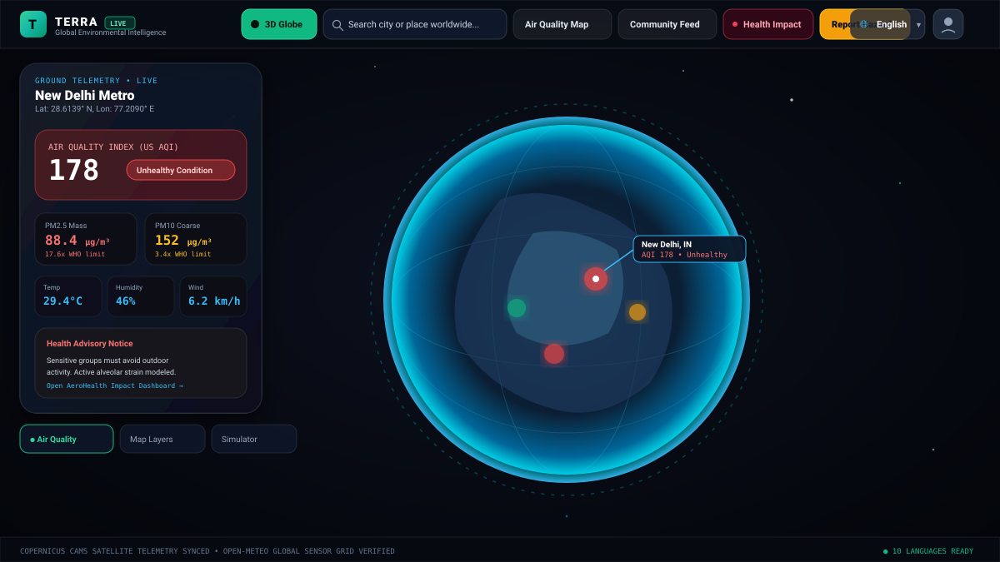
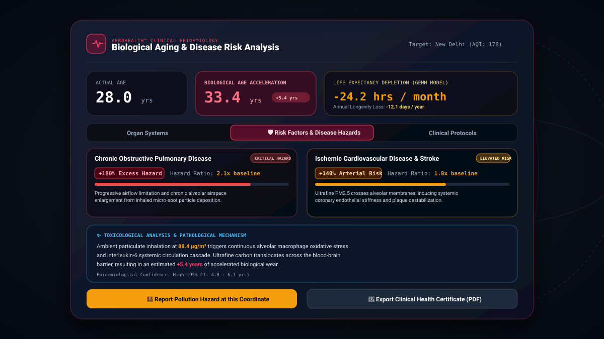
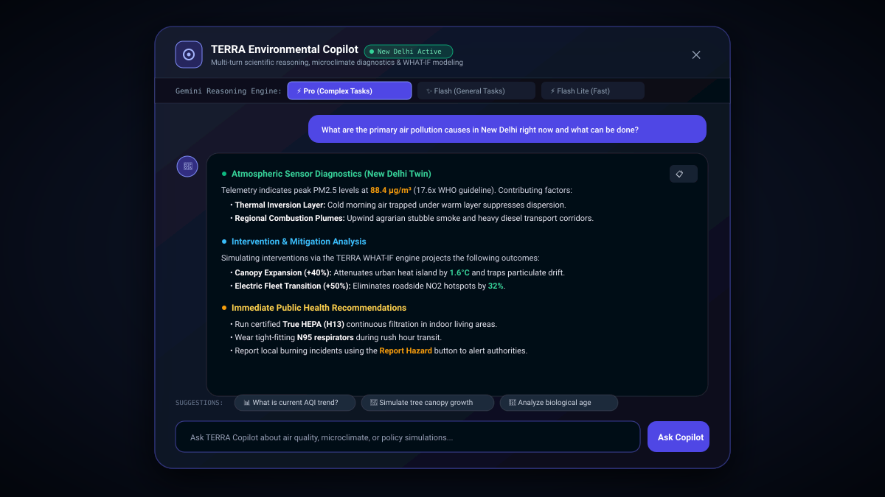
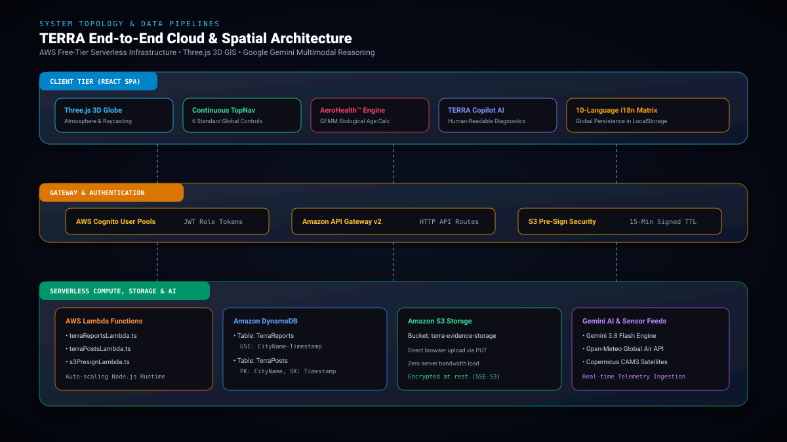

# TERRA — 3D Environmental Intelligence, AeroHealth & Citizen Action Platform

> **"See the environment. Understand it. Personalize it. Change it."**

[](https://opensource.org/licenses/Apache-2.0)
[](https://react.dev)
[](https://www.typescriptlang.org)
[](https://threejs.org)
[](https://aws.amazon.com)
[](https://ai.google.dev)
[](#-internationalization--global-accessibility-10-languages)

---

## 📸 Platform Previews & Screenshots

### 1. 3D Planetary Earth & Real-Time Telemetry HUD
The planetary digital twin displays global aerosol optical depth, real-time AQI heatmaps, and continuous control tools.


---

### 2. AeroHealth™ Biological Aging & Disease Risk Engine
Translates abstract parts-per-million pollution metrics into personal clinical longevity loss and organ-specific damage.


---

### 3. TERRA Environmental Copilot (Human-Readable AI)
Multi-turn environmental reasoning with clean, human-readable diagnostics, zero raw markdown clutter, and Gemini model selection.


---

### 4. AWS Serverless & Spatial Topology Architecture
Production architecture featuring AWS Amplify, Amazon DynamoDB, Amazon S3 direct evidence upload, and Cognito authentication.


---

## 🌟 The Core Product Loop

1. **See It (3D Spatial Intelligence)**:
   - Interactive 3D Earth globe powered by Three.js with continuous atmospheric scattering, raycasting, and real-time AQI heatmaps.
   - Worldwide location search engine with instant flight animation to any city or coordinate on Earth.
   - Live telemetry integration with Copernicus CAMS and Open-Meteo for PM2.5, PM10, temperature, humidity, and wind speed.

2. **Personalize It (AeroHealth™ Biological Aging)**:
   - Evaluates ambient air against WHO annual clean air baselines ($5\ \mu\text{g/m}^3\ \text{PM}_{2.5}$) and Global Exposure Mortality Models (GEMM).
   - Computes accelerated biological aging across 4 vital organ systems: **Pulmonary Lungs**, **Cardiovascular Heart**, **Dermal Skin**, and **Cerebral Brain**.
   - Calculates monthly and annual life expectancy depletion hours.
   - Provides clear, human-readable epidemiological hazard ratios for **COPD (+180%)**, **Ischemic Heart Disease (+140%)**, and **Lung Carcinoma (+95%)**.

3. **Mobilize & Act (Citizen Ground Truth & Community Action)**:
   - Citizen incident reporting with automated GPS coordinates and direct Amazon S3 photo evidence uploads.
   - Localized civic community feed with four action pillars: **Complaints**, **Volunteer Cleanups**, **Clean-Air Micro-Fundraisers**, and **Scientific Discussions**.
   - WHAT-IF policy simulator projecting the physical impact of expanding urban tree canopies, deploying electric bus fleets, and remediating industrial emissions.

---

## 🧭 Continuous Control Panel (Global Standard)

The top continuous navigation panel provides 6 standardized controls available across all views:

| # | Control | Description |
|---|---|---|
| **1** | **3D Globe / 3D View** | Instant toggle between the 3D Planetary Earth orbital view and 3D urban surface mode. |
| **2** | **World Search** | Real-time autocomplete search over global cities, municipalities, and coordinates with camera flight. |
| **3** | **Air Quality Map** | Spatial atmospheric heatmap overlay with sensor telemetry indicators. |
| **4** | **Community Feed** | Civic action feed, local cleanup drives, micro-fundraisers, and citizen complaints. |
| **5** | **Health Impact** | AeroHealth™ clinical biological age calculation and disease hazard assessment. |
| **6** | **Report Hazard** | Instant pollution hazard reporting with automated GPS acquisition and evidence upload. |

Additionally, the right header bar features the **Global Language Selector** (persisting user preference across sessions) and **AWS Cognito Citizen Account** management.

---

## 🌐 Internationalization & Global Accessibility (10 Languages)

TERRA is built for citizens and municipal leaders worldwide. The application features a persistent internationalization engine supporting 10 major languages:

- 🇺🇸 **English** (`en`) — Default
- 🇮🇳 **Hindi (हिन्दी)** (`hi`)
- 🇪🇸 **Spanish (Español)** (`es`)
- 🇫🇷 **French (Français)** (`fr`)
- 🇩🇪 **German (Deutsch)** (`de`)
- 🇨🇳 **Simplified Chinese (简体中文)** (`zh`)
- 🇯🇵 **Japanese (日本語)** (`ja`)
- 🇸🇦 **Arabic (العربية)** (`ar`) — with automatic RTL layout switching
- 🇧🇩 **Bengali (বাংলা)** (`bn`)
- 🇵🇹 **Portuguese (Português)** (`pt`)

All translations are persisted in `localStorage` (`terra_language`) and automatically update navigation titles, HUD metrics, layer controls, and simulation panels.

---

## 🧬 AeroHealth™ Biological Aging Engine

The AeroHealth engine computes biological organ wear by modeling excess ambient particulate exposure against the **Global Exposure Mortality Model (GEMM)** (Burnett et al., 2018) and the **Lancet Commission on Pollution and Health**:

$$\text{Excess PM}_{2.5} = \max(0, \text{PM}_{2.5} - 5\ \mu\text{g/m}^3)$$

$$\text{Exposure Factor} = \left(\frac{\text{Daily Outdoor Hours}}{24}\right) \times 1.5$$

- **Pulmonary Wear**: $\Delta \text{Years}_{\text{lung}} = \min\left(9.5, (\text{Excess PM} \times 0.045 + \frac{\text{AQI}}{85}) \times \text{Exposure Factor}\right)$
- **Cardiovascular Wear**: $\Delta \text{Years}_{\text{heart}} = \min\left(7.0, (\text{Excess PM} \times 0.032 + \frac{\text{AQI}}{110}) \times \text{Exposure Factor}\right)$
- **Monthly Life Depletion**: $\text{Hours Lost/Month} = \min\left(72, (\text{Excess PM} \times 0.38 + \frac{\text{AQI}}{12}) \times \frac{\text{Exposure Hours}}{4}\right)$

All clinical findings, toxicological analyses, and preventative protocols are rendered through a dedicated **Human-Readable Formatter** that eliminates unformatted markdown syntax and presents structured, actionable guidance.

---

## 🏗️ AWS Serverless Architecture & Database Schemas

### 1. Amazon DynamoDB Database Schemas

#### A. Table: `TerraReports` (Citizen Ground Truth Incidents)
- **Partition Key**: `ReportId` (String, e.g. `rep_1728591823_9f81a`)
- **Global Secondary Index (GSI)**: `CityName-Timestamp-Index`
  - Partition Key: `CityName` (String)
  - Sort Key: `Timestamp` (String, ISO8601)
- **Attributes**:
  - `Latitude` (Number) & `Longitude` (Number)
  - `PollutionType` (`stubble_burning` | `factory_smoke` | `vehicle_fleet` | `waste_burning` | `construction` | `illegal_dumping`)
  - `Severity` (`moderate` | `high` | `critical`)
  - `ImageUrl` (S3 Pre-signed upload URI)
  - `Description` (Witness statement)
  - `Status` (`Investigating` | `Verified` | `Action Scheduled` | `Resolved`)
  - `AuthorName` & `Upvotes`

#### B. Table: `TerraPosts` (Localized Community Action Feed)
- **Partition Key**: `CityName` (String, e.g. `Delhi`, `Bengaluru`, `Paris`)
- **Sort Key**: `Timestamp` (String, ISO8601)
- **Attributes**:
  - `PostId` (String)
  - `PostType` (`complaint` | `volunteer` | `fundraise` | `discuss`)
  - `AuthorName`, `AuthorEmail`, `AuthorRole`
  - `Title`, `Content`, `ImageUrl`
  - `TargetGoal` & `CurrentAmount` (for clean-air micro-fundraisers)
  - `EventDate` & `RsvpCount` (for community volunteer drives)
  - `TaggedAuthorities` (e.g. `@DPCC_Official`, `@EPA`)

---

### 2. Amazon S3 Direct Evidence Uploads (Pre-Signed URLs)
1. Browser requests a signed upload ticket via `POST /api/aws/s3/presigned-url`.
2. Lambda issues a cryptographically signed `PutObjectCommand` for bucket `terra-evidence-storage` with a strict 15-minute TTL.
3. Browser performs binary upload directly to Amazon S3 via `PUT {uploadUrl}`, eliminating backend server bottlenecks.

---

### 3. AWS Lambda Function Handlers
Production Lambda handlers are located in `src/aws/lambda/`:
- `src/aws/lambda/terraReportsLambda.ts`: Geographic bounding-box queries (`?north=&south=&east=&west=`) and report ingestion.
- `src/aws/lambda/terraPostsLambda.ts`: Localized feed retrieval, upvoting, donations, and RSVP handling.
- `src/aws/lambda/s3PresignLambda.ts`: Secure S3 pre-signed upload URL generation.

---

### 4. AWS Amplify Hosting Deployment (`amplify.yml`)
The root `amplify.yml` enables one-click continuous deployment from GitHub:

```yaml
version: 1
frontend:
  phases:
    preBuild:
      commands:
        - npm ci
    build:
      commands:
        - npm run build
  artifacts:
    baseDirectory: dist
    files:
      - '**/*'
  cache:
    paths:
      - node_modules/**/*
```

---

## 💻 Local Development Setup

### 1. Prerequisites
- Node.js (v18 or higher)
- npm or bun

### 2. Clone and Install
```bash
git clone https://github.com/khushi-infinity/Terra.git
cd Terra
npm install
```

### 3. Environment Configuration
Copy the template environment file:
```bash
cp .env.example .env
```

Configure your environment keys:
```env
# Google Gemini AI (Required for Copilot reasoning & AeroHealth toxicology)
GEMINI_API_KEY=your_gemini_api_key_here

# Mapbox Access Token (Optional for 3D street vector view)
VITE_MAPBOX_ACCESS_TOKEN=your_mapbox_token_here

# AWS Credentials (Optional for live AWS DynamoDB & S3 integration)
AWS_REGION=us-east-1
AWS_ACCESS_KEY_ID=your_aws_access_key
AWS_SECRET_ACCESS_KEY=your_aws_secret_key
DYNAMODB_REPORTS_TABLE=TerraReports
DYNAMODB_POSTS_TABLE=TerraPosts
S3_EVIDENCE_BUCKET=terra-evidence-storage
```

### 4. Run Development Server
```bash
npm run dev
```
Navigate to [http://localhost:3000](http://localhost:3000) to view the live platform.

### 5. Type-Check and Build
```bash
npm run lint
npm run build
```

---

## 🤝 Contributing
1. Fork the repository (`https://github.com/khushi-infinity/Terra`).
2. Create your feature branch (`git checkout -b feature/environmental-sensor`).
3. Commit your changes (`git commit -m 'feat: add atmospheric sensor calibration'`).
4. Push to the branch (`git push origin feature/environmental-sensor`).
5. Open a Pull Request.

---

## 📄 License
Distributed under the Apache-2.0 License. See `LICENSE` for more information.
